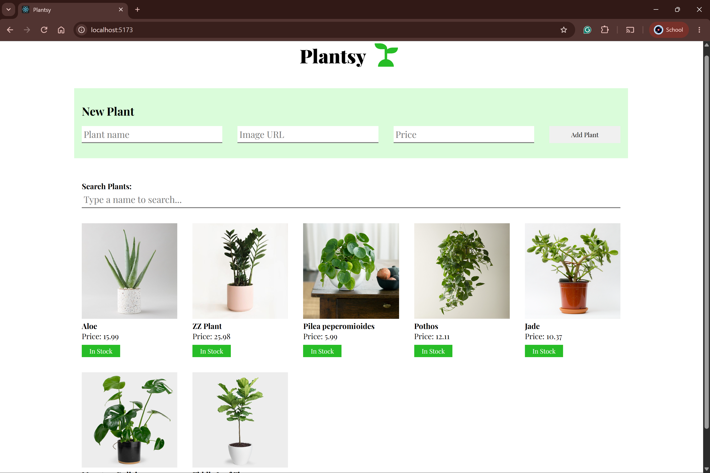

# Plantsy

A React plant shop app connected to a JSON Server backend. Users can browse plants, add new ones, mark plants as sold out, and search by name.



## Features

- View all plants on page load (fetched from the backend with `useEffect`)
- Add a new plant with the form (POST request, saved to the backend)
- Toggle a plant between "In Stock" and "Out of Stock" (stored in local state, resets on refresh)
- Search plants by name (case-insensitive filter)

## Installation

1. Fork and clone this repository.
2. Install dependencies:
   ```
   npm install
   ```

## Usage

Run the backend (port 6001) and the React app in two separate terminals:

```
npm run server
npm run dev
```

Open the local address printed by Vite (usually `http://localhost:5173`).

To run the tests:

```
npm run test
```

## Built With

- React (hooks: `useState`, `useEffect`)
- Vite
- JSON Server
- Vitest

## Author

Collins-kc
